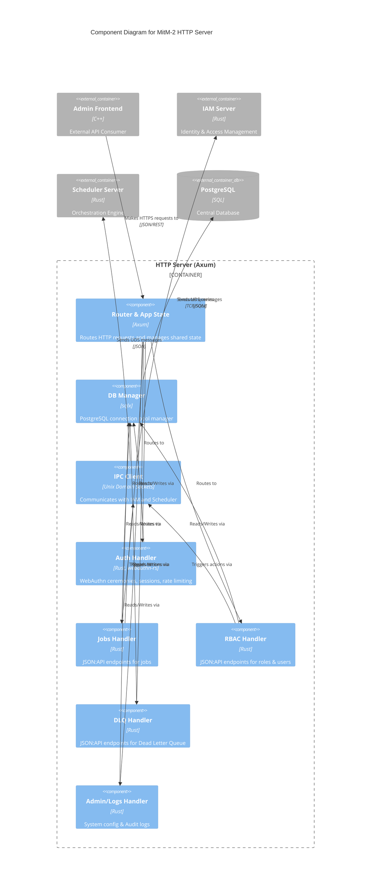

# mitm_http-server

The HTTP Server acts as the API Gateway for the MitM-2 architecture. It provides a RESTful interface adhering to the JSON:API standard, serving external consumers like the C++ Admin Frontend.

## Architecture & Components

The server is built on **Axum** and uses **sqlx** for asynchronous PostgreSQL access. It communicates with other internal microservices via Unix Domain Sockets (UDS).

### C4 Component Diagram



## Authentication & WebAuthn
- **WebAuthn FIDO2 / Passkeys**: Provides Relying Party ceremony endpoints under `/api/v1/auth/webauthn/*` (`register/start`, `register/finish`, `login/start`, `login/finish`) and `/api/v1/auth/bootstrap/status`.
- **Passkey-only Sessions**: Session tokens are issued only after a server-verified WebAuthn ceremony (`login/finish`, or `register/finish` for the bootstrap administrator). There is no password- or username-only login.
- **Rate Limiting**: The public WebAuthn and bootstrap endpoints accept 20 requests per minute per client IP; excess requests receive `429 Too Many Requests`.
- **Client IP**: Sessions store the client IP taken from the TCP connection, or from the rightmost `X-Forwarded-For` entry when `MITM_TRUST_PROXY_HEADERS=true`. Client-supplied IPs in request payloads are not accepted.
- **RBAC & Trust Proxy**: Enforces role memberships and integrates with the IAM microservice via Unix Domain Sockets.

### Initial Administrator (Bootstrap)
1. Set `INITIAL_ADMIN_TOKEN` (at least 32 characters, e.g. from AWS Secrets Manager) in the ECS task definition. If no user exists and the token is missing or too short, the server logs a `FATAL` error and exits (the IAM and Scheduler child processes are stopped as well).
2. Start the system. `GET /api/v1/auth/bootstrap/status` returns `bootstrap_required: true`.
3. Register the first administrator in the Admin Frontend with a passkey and the bootstrap token. The account is active immediately and receives the `ADMIN` role.
4. Further users register themselves (inactive until approved) or are managed by administrators. Once a user exists, the bootstrap path is closed and the token is no longer used; it may be removed from the task definition.

Concurrent bootstrap ceremonies create at most one administrator; later attempts receive `409 Conflict`.

### Running behind AWS ALB
An ALB terminates the client connection, so the server only sees the ALB's private IP as peer address. Set `MITM_TRUST_PROXY_HEADERS=true` so the client IP is taken from the rightmost `X-Forwarded-For` entry, which the ALB appends. Requirements:
- The ECS task's security group allows inbound traffic only from the ALB.
- The ALB attribute `routing.http.xff_header_processing.mode` is `append` (default).

Leave the variable unset when the server is reachable directly, otherwise clients can spoof their IP and bypass the rate limit.

Set `WEBAUTHN_RP_ID` and `WEBAUTHN_RP_ORIGIN` to the public host name and origin of the web frontend (e.g. `mitm.example.com` / `https://mitm.example.com`). With the defaults (`localhost`) the browser refuses passkeys on any other address ("WebAuthn RP ID / origin mismatch"). WebAuthn requires HTTPS and a DNS name, so terminate TLS on the ALB (ACM certificate) and do not use IP addresses.

### Upgrading from 1.x
`POST /api/v1/auth/session` was removed. Clients must authenticate via the WebAuthn login ceremony (see [API v1 Documentation](./docs/api/api_v1.md)).

## Configuration

- `INITIAL_ADMIN_TOKEN` (required while no user exists): Secret bootstrap token (at least 32 characters) for registering the initial active administrator account. If no user exists and the token is missing or too short, the server logs an error and exits.
- `MITM_TRUST_PROXY_HEADERS` (optional, default `false`): Take the client IP from the rightmost `X-Forwarded-For` entry. Enable only behind a load balancer (e.g. AWS ALB) that sets this header.
- `WEBAUTHN_RP_ID` (default `localhost`): WebAuthn Relying Party ID, the host name of the web frontend without scheme and port. Registered passkeys are bound to it.
- `WEBAUTHN_RP_ORIGIN` (default `http://localhost:<MITM_HTTP_PORT>`): Exact browser origin of the web frontend (`scheme://host[:port]`). Its host must equal `WEBAUTHN_RP_ID` or be a subdomain of it. Local development with `ng serve`: `WEBAUTHN_RP_ID=localhost`, `WEBAUTHN_RP_ORIGIN=http://localhost:4200`.
- `MITM_DB_URL` (optional): PostgreSQL Connection String.
- `IAM_SOCKET_PATH` (optional): Path to the IAM UDS.
- `SCHEDULER_SOCKET_PATH` (optional): Path to the Scheduler UDS.

## Execution

```bash
cargo run -p mitm-http-server
```
