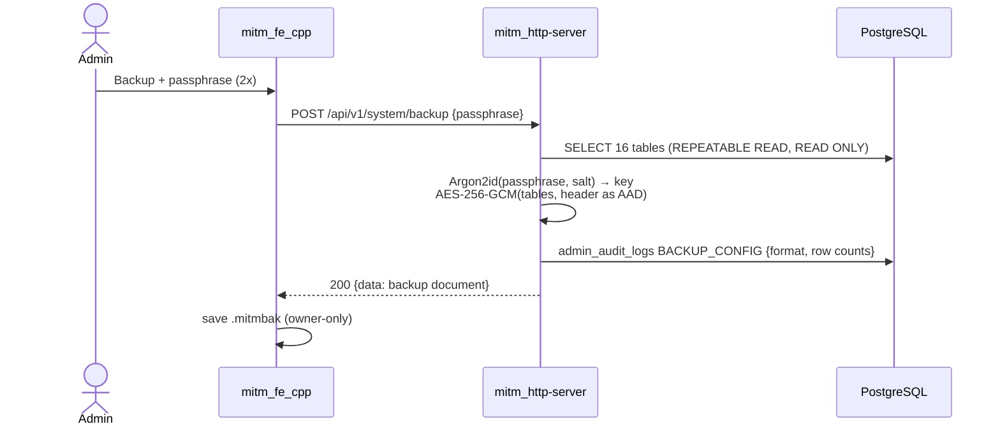
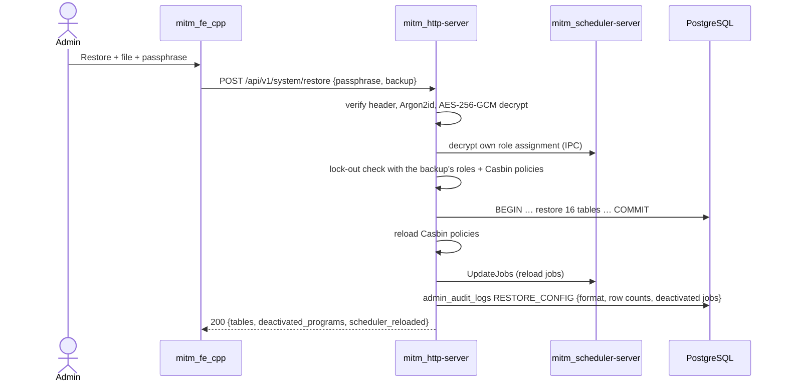

# Configuration Backup & Restore

> Applies to `mitm_http-server` **≥ 3.6.0** and `mitm_fe_cpp` **≥ 2.3.0**.
> Background: [core-layer#99](https://github.com/Zheng-Bote/mitm_core-layer/issues/99), [mitm_fe_cpp#49](https://github.com/Zheng-Bote/mitm_fe_cpp/issues/49) · API reference: [API v1 – Configuration backup and restore](api/api_v1.md#configuration-backup-and-restore)

The configuration backup exports everything needed to rebuild a MitM installation's configuration — jobs, credentials, delivery targets, mappings, keys, users and RBAC — as **one encrypted file**. The restore writes it back in **one transaction**: either everything is restored or nothing changes.

## Contents

- [What is backed up](#what-is-backed-up)
- [Encryption](#encryption)
- [Creating a backup](#creating-a-backup)
- [Restoring a backup](#restoring-a-backup)
- [Restore rules](#restore-rules)
- [Lock-out protection](#lock-out-protection)
- [Restoring into another environment](#restoring-into-another-environment)
- [Permissions](#permissions)
- [Errors](#errors)
- [Operational recommendations](#operational-recommendations)
- [Upgrading from versions before 3.6.0](#upgrading-from-versions-before-360)

## What is backed up

| Area | Tables |
| --- | --- |
| Keys | `storage_keys` (wrapped DEKs) |
| Scheduler | `scheduled_programs`, `scheduler_config` |
| Sources & targets | `source_credentials`, `delivery_targets` |
| Transformation | `mapping_source`, `mapping_target_field`, `mapping_rule`, `mapping_transformation`, `mapping_validation`, `topic_dependencies` |
| Users & RBAC | `admin_users`, `user_roles_encrypted`, `webauthn_credentials`, `roles`, `casbin_rule` |

**Not** backed up (runtime data): `program_runs`, `job_status_events`, `job_audit_logs`, `system_logs`, `admin_audit_logs`, `packages`, `dead_letter_queue`, `raw_ingestion`, `target_fragments`, `transformation_errors`, `ingestion_cursors`, `adapter_tokens`, `user_sessions`, `webauthn_states`, `monitor_state`, `monitor_alerts`.

All tables are read in one `REPEATABLE READ` snapshot, so the backup is consistent even while jobs are running.

## Encryption

The **whole backup** is encrypted on the server before it is sent:

| | |
| --- | --- |
| Cipher | AES-256-GCM (authenticated encryption) |
| Key derivation | Argon2id, 64 MiB memory, 3 iterations, parallelism 1, random 16-byte salt |
| Passphrase | entered by the admin, at least **12 characters**; never stored or logged |
| Integrity | all header fields (format, server version, time, KDF parameters, salt, nonce) are authenticated as associated data — any change to header or ciphertext makes the restore fail |

Columns that are already encrypted in the database (`config_payload` of credentials and targets, encrypted role assignments, wrapped keys) **stay encrypted inside the backup** as well (envelope encryption with the `MASTER_KEY`).

The backup file is a JSON document with a readable header and the ciphertext:

```json
{
  "format": 1,
  "server_version": "3.6.0",
  "created_at": "2026-11-18T12:00:00+00:00",
  "kdf": { "algorithm": "argon2id", "version": 19, "m_cost_kib": 65536, "t_cost": 3, "p_cost": 1, "salt": "<base64>" },
  "cipher": { "algorithm": "AES-256-GCM", "nonce": "<base64>" },
  "ciphertext": "<base64>"
}
```

> [!IMPORTANT]
> **Without the passphrase a backup cannot be restored.** There is no recovery mechanism. Store the passphrase in your password manager / vault, separately from the backup file.

> [!NOTE]
> The server does not enforce HTTPS. Int and Prod provide transport encryption through the infrastructure. On plain-HTTP environments (Dev) the passphrase travels unencrypted in the request body — use test passphrases only.

## Creating a backup

**Admin frontend (`mitm_fe_cpp`):** *System / Settings → Backup/Restore → Backup Configuration*

1. Enter the passphrase twice.
2. The backup is saved as `<Binary-Folder>/data/backup/<timestamp>_backup-<config>_<user>.mitmbak`, readable only by the current OS user.



**API:**

```bash
curl -s -X POST "$MITM_URL/api/v1/system/backup" \
  -H "Authorization: Bearer $TOKEN" -H "Content-Type: application/json" \
  -d '{"passphrase":"<at least 12 characters>"}' | jq '.data' > backup.mitmbak
```

## Restoring a backup

**Admin frontend:** *System / Settings → Backup/Restore → Restore Configuration*

1. Select the `.mitmbak` file (old unencrypted `.json` backups are rejected, see [below](#upgrading-from-versions-before-360)).
2. Confirm the restore.
3. Enter the passphrase.
4. The result shows the restored tables/rows and the jobs that were deactivated.



**API:**

```bash
jq -n --arg p "<passphrase>" --slurpfile b backup.mitmbak '{passphrase: $p, backup: $b[0]}' \
| curl -s -X POST "$MITM_URL/api/v1/system/restore" \
    -H "Authorization: Bearer $TOKEN" -H "Content-Type: application/json" --data-binary @-
```

Response `data`:

```json
{ "tables": { "scheduled_programs": 12, "roles": 4, "...": 0 }, "deactivated_programs": ["job_created_after_backup"], "scheduler_reloaded": true }
```

## Restore rules

| Table(s) | Behaviour |
| --- | --- |
| `storage_keys` | **added only** (`ON CONFLICT DO NOTHING`); existing keys are never deleted, they may still encrypt `raw_ingestion` data |
| `scheduled_programs` | **upserted by `id`**; jobs that are not in the backup are **deactivated** (`enabled = false`), never deleted — their `program_runs`, `job_status_events` and `job_audit_logs` are kept |
| all other tables | **replaced**: cleared children-first, inserted parents-first (respecting foreign keys such as `mapping_rule → mapping_source / mapping_target_field`, `source_credentials → storage_keys`, `user_roles_encrypted → admin_users`) |
| sequences | moved **forward** to at least the highest restored ID, never backwards |

- Everything runs in **one transaction**. On any error nothing is changed; the error message names the failing table.
- After the commit the RBAC policies are reloaded immediately and the scheduler reloads its jobs. If the scheduler cannot be reached, the restore still succeeds and `scheduler_reloaded` is `false` — restart the scheduler then.
- Active sessions stay valid. Users that are not contained in the backup lose access with their next request.

## Lock-out protection

Before any data is changed, the server checks that the **user performing the restore can still restore afterwards**, using the users, roles and Casbin policies **from the backup**:

- the user must exist in the backup and be active;
- one of the user's roles must be allowed `POST /api/v1/system/restore` by the backup's `casbin_rule`;
- a user without any role assignment counts as `ADMIN` (same rule as the session check).

Otherwise the restore is rejected with `409 RESTORE_LOCKOUT` and nothing is changed.

## Restoring into another environment

A backup can be restored into another database (e.g. disaster recovery, Int → new Int) when:

1. the **passphrase** is known, **and**
2. the target runs with the **same `MASTER_KEY`** — otherwise credentials, targets and role assignments cannot be decrypted;
3. the database schema is current (`migrations/setup.sql` and the migrations of the release).

WebAuthn security keys are bound to the RP ID/origin of the environment. If the target environment uses a different RP ID, users have to register their keys again (OIDC login is not affected).

## Permissions

Backup and restore are authorized by Casbin like every API call. With the default policies only `ADMIN` (`/api/v1/*`, all methods) may call them.

> [!NOTE]
> The role `BACKUP-RESTORE` exists and `mitm_fe_cpp` shows the *Backup/Restore* tab to it, but the default `casbin_rule` contains **no policy** for it — the server answers `403 RBAC_FORBIDDEN`. To let it use backup/restore, add:
>
> | ptype | v0 | v1 | v2 |
> | --- | --- | --- | --- |
> | `p` | `BACKUP-RESTORE` | `/api/v1/system/backup` | `POST` |
> | `p` | `BACKUP-RESTORE` | `/api/v1/system/restore` | `POST` |

## Errors

| HTTP | `code` | Meaning | What to do |
| --- | --- | --- | --- |
| 422 | `VALIDATION_FAILED` | passphrase shorter than 12 characters | choose a longer passphrase |
| 422 | `BACKUP_DECRYPTION_FAILED` | wrong passphrase, or the file was modified/damaged | check the passphrase; use an intact copy |
| 422 | `BACKUP_FORMAT_UNSUPPORTED` | unencrypted backup of a version < 3.6.0, or unknown `format` | create a new backup with ≥ 3.6.0 |
| 409 | `RESTORE_LOCKOUT` | after the restore you could no longer restore (missing/inactive user, no permitted role) | restore with a user that exists in the backup with sufficient rights |
| 503 | `SERVICE_UNAVAILABLE` | own role assignment cannot be decrypted (scheduler crypto via IPC unavailable) | check `mitm_scheduler-server`, retry |
| 500 | `INTERNAL_ERROR` | database error; detail names the table (`Restore failed at table …`) — nothing was changed | check the server log and the schema version |

Every backup and restore is recorded in `admin_audit_logs` (`BACKUP_CONFIG` / `RESTORE_CONFIG`) with format version and row count per table; restores also list the deactivated jobs.

## Operational recommendations

- **Before every update** of the core layer, create a backup.
- Keep backups and passphrases **separately**; the file alone is useless, the passphrase alone too.
- The backup contains password hashes, WebAuthn public keys and the wrapped keys — treat it as **confidential** even though it is encrypted.
- Test a restore regularly on a non-production environment (same `MASTER_KEY`).
- After a restore, check the list of **deactivated jobs** and re-enable the ones still needed.

## Upgrading from versions before 3.6.0

- Backups created before `mitm_http-server` 3.6.0 were **unencrypted JSON** and incomplete (no keys, users or RBAC). They can **no longer be restored** (`BACKUP_FORMAT_UNSUPPORTED`); the frontend rejects them before sending.
- `GET /api/v1/system/backup` was replaced by `POST /api/v1/system/backup` with a passphrase.
- Server and frontend must be updated together (`mitm_http-server` 3.6.0 + `mitm_fe_cpp` 2.3.0).
- **Create a new backup right after the update.**
